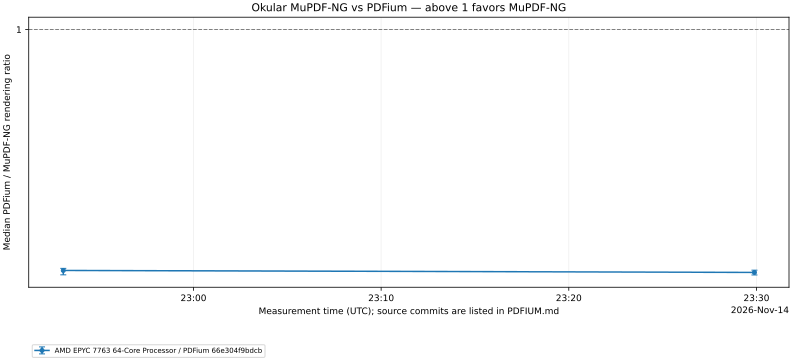

# MuPDF-NG vs PDFium benchmark history

Ratio = PDFium rendering time / MuPDF-NG rendering time; values above 1 favor MuPDF-NG. Opening and worker startup are excluded. Each PDF has equal weight.

<!-- pdfium-history:start -->

Lines group runs by CPU, PDFium library, corpus, and workload. Intervals describe within-run variability.

| Date | MuPDF-NG commit / package | PDFium commit | Median ratio (95% interval) | Repeats/PDF | Run |
|---|---|---|---:|---:|---|
| 2026-11-14 | okular-mupdf-ng 0.6.3-1 | [9faa704a1051](https://github.com/l4rzy/okular-backend-pdfium/commit/9faa704a10511654cf5e38e2285a61167cd65947) | 0.734× (0.730–0.736) | 30 | [details](https://github.com/l4rzy/okular-backends-benchmark/actions/runs/43649250177) |
<!-- pdfium-history:end -->

<!-- pdfium-latest:start -->
## Latest per-document results

Ratios are medians of paired trial ratios. Times are median milliseconds.

| PDF | Pages | PDFium / MuPDF-NG | MuPDF-NG render | PDFium render |
|---|---:|---:|---:|---:|
| 2609.00625v1 | 14 | 0.916× | 2955.675 | 2702.021 |
| 2609.09123v1 | 24 | 0.793× | 2729.578 | 2167.181 |
| 2610.26067v1 | 16 | 0.795× | 3424.992 | 2722.237 |
| 2312.00752v2 | 36 | 0.576× | 734.283 | 421.897 |
| 2307.03109v9 | 45 | 0.636× | 672.889 | 429.526 |

Latest run: [43649250177-1](https://github.com/l4rzy/okular-backends-benchmark/actions/runs/43649250177); PDFium library SHA-256 `66e304f9bdcbab0ffcf20f50bd045ff64741f868c035c14fe717d9f59e628dae`.
<!-- pdfium-latest:end -->
