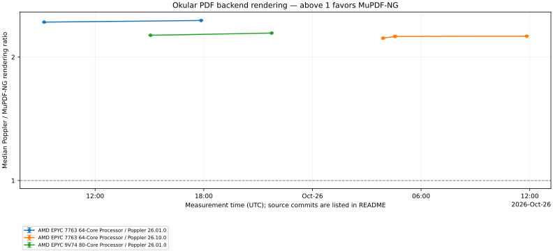

# Okular Backends Benchmark

Versioned PDF corpus and historical performance comparisons for Okular backends.

## Corpus v1

Five unmodified arXiv PDFs licensed under Creative Commons Attribution 4.0: three image-heavy graphics papers, one equation-heavy paper, and one text/table-heavy survey. All versions are pinned and their exact bytes are identified by SHA-256. Inclusion does not imply endorsement by the authors or arXiv.

| Paper | Version | Pages | Size (MiB) | Workload | License |
|---|---|---:|---:|---|---|
| [Inverse Rendering for Modeling with Line Primitives](https://arxiv.org/abs/2609.00625v1) | [2609.00625v1](corpus/arxiv/2609.00625v1.pdf) | 14 | 47.58 | image-heavy graphics | [CC BY 4.0](https://creativecommons.org/licenses/by/4.0/) |
| [Mask Forcing: Improving Autoregressive Video Diffusion Distillation via Dual-Noise Masking Rollout](https://arxiv.org/abs/2609.09123v1) | [2609.09123v1](corpus/arxiv/2609.09123v1.pdf) | 24 | 46.61 | image-heavy graphics | [CC BY 4.0](https://creativecommons.org/licenses/by/4.0/) |
| [PhysSkin++: Real-Time and Generalizable Physics-Based Animation via Self-Supervised Neural Skinning](https://arxiv.org/abs/2610.26067v1) | [2610.26067v1](corpus/arxiv/2610.26067v1.pdf) | 16 | 42.45 | image-heavy graphics | [CC BY 4.0](https://creativecommons.org/licenses/by/4.0/) |
| [Mamba: Linear-Time Sequence Modeling with Selective State Spaces](https://arxiv.org/abs/2312.00752v2) | [2312.00752v2](corpus/arxiv/2312.00752v2.pdf) | 36 | 1.11 | math, algorithms, numerical tables | [CC BY 4.0](https://creativecommons.org/licenses/by/4.0/) |
| [A Survey on Evaluation of Large Language Models](https://arxiv.org/abs/2307.03109v9) | [2307.03109v9](corpus/arxiv/2307.03109v9.pdf) | 45 | 0.98 | dense text, survey tables, references | [CC BY 4.0](https://creativecommons.org/licenses/by/4.0/) |

## Attribution

### Inverse Rendering for Modeling with Line Primitives

Kenji Tojo; Ariel Shamir; Nobuyuki Umetani; Bernd Bickel.

Original version: [2609.00625v1](https://arxiv.org/abs/2609.00625v1). [Original PDF](https://arxiv.org/pdf/2609.00625v1). Licensed under [Creative Commons Attribution 4.0 International](https://creativecommons.org/licenses/by/4.0/). No changes were made to the PDF.

### Mask Forcing: Improving Autoregressive Video Diffusion Distillation via Dual-Noise Masking Rollout

Zhuoran Zhao; Shengju Qian; Tongtong Liang; Xianghao Kong; Songchun Zhang; Junchao Huang; Guian Fang; Xin Wang; Pan Hui; Anyi Rao.

Original version: [2609.09123v1](https://arxiv.org/abs/2609.09123v1). [Original PDF](https://arxiv.org/pdf/2609.09123v1). Licensed under [Creative Commons Attribution 4.0 International](https://creativecommons.org/licenses/by/4.0/). No changes were made to the PDF.

### PhysSkin++: Real-Time and Generalizable Physics-Based Animation via Self-Supervised Neural Skinning

Yuanhang Lei; Baofei Liu; Xingxuan Li; Tao Cheng; Zixuan Wang; Boming Zhao; Yujun Shen; Siyuan Huang; Ruizhen Hu; Peter Yichen Chen; Hujun Bao; Zhaopeng Cui.

Original version: [2610.26067v1](https://arxiv.org/abs/2610.26067v1). [Original PDF](https://arxiv.org/pdf/2610.26067v1). Licensed under [Creative Commons Attribution 4.0 International](https://creativecommons.org/licenses/by/4.0/). No changes were made to the PDF.

### Mamba: Linear-Time Sequence Modeling with Selective State Spaces

Gu, Albert; Dao, Tri.

Original version: [2312.00752v2](https://arxiv.org/abs/2312.00752v2). [Original PDF](https://arxiv.org/pdf/2312.00752v2). Licensed under [Creative Commons Attribution 4.0 International](https://creativecommons.org/licenses/by/4.0/). No changes were made to the PDF.

### A Survey on Evaluation of Large Language Models

Chang, Yupeng; Wang, Xu; Wang, Jindong; Wu, Yuan; Yang, Linyi; Zhu, Kaijie; Chen, Hao; Yi, Xiaoyuan; Wang, Cunxiang; Wang, Yidong; Ye, Wei; Zhang, Yue; Chang, Yi; Yu, Philip S.; Yang, Qiang; Xie, Xing.

Original version: [2307.03109v9](https://arxiv.org/abs/2307.03109v9). [Original PDF](https://arxiv.org/pdf/2307.03109v9). Licensed under [Creative Commons Attribution 4.0 International](https://creativecommons.org/licenses/by/4.0/). No changes were made to the PDF.

## Integrity and reproducibility

`corpus/manifest.json` records authors, versioned source links, licenses, page counts, sizes, and hashes. Only these five CC BY 4.0 papers are mirrored; other local books and papers without redistribution permission are not included.

Verify files from the repository root:

```sh
sha256sum --check corpus/SHA256SUMS
```

Keep corpus v1 unchanged once published. Future additions or replacements should increment the corpus version so historical benchmark results remain comparable.

## Licensing

The papers are third-party works licensed individually under CC BY 4.0. Retain the author credits, source links, license links, and original copyright/license notices when redistributing them.

The benchmark harness and automation are licensed under GPL-3.0-or-later; see [COPYING](COPYING).

## Running the benchmark

The [standalone harness](bench/README.md) builds and measures a selected commit
of [okular-mupdf-ng](https://github.com/l4rzy/okular-mupdf-ng) against the official
installed Poppler backend. Use `make bench` locally with a separately built plugin.
Python tooling and Matplotlib are managed by uv with locked dependencies.

The **PDF backend benchmark** workflow runs weekly on Monday at 05:23 UTC and
manually through the Actions tab. Manual runs accept a plugin branch, tag, or
commit and the number of paired trials (default 30 per PDF). Results record the
resolved plugin commit, benchmark commit, corpus, CPU, and dependency versions.
No push trigger or cross-repository publishing secret is required.

The headline is the median paired Poppler / MuPDF-NG rendering ratio; above 1
favors MuPDF-NG. Each PDF has equal weight. The worker stays alive throughout
each trial, and startup is reported separately. Successful runs append tables
here, generate `trend.svg`, and retain detailed reports and compressed samples
under `reports/<plugin-sha>/<run-attempt>/`. The first real published run creates
the graph and history section. See the [methodology and CI setup](bench/README.md).

Benchmarks use Relaxed sandbox enforcement so real documents can open on
container runners with partial hardening. Available worker sandbox protections
remain enabled. Corpus page counts are checked before rendering, and failures
stop immediately rather than timing error placeholders.

<!-- benchmark-history:start -->
## Backend performance history



Median ratio = Poppler / MuPDF-NG rendering time; **above 1 favors MuPDF-NG**. Opening and worker startup are excluded. Each PDF has equal weight. Lines connect only comparable environment/corpus/protocol series. Intervals describe within-run variability, not hardware-independent uncertainty.

| Measured UTC | Source commit | Median ratio (95% interval) | Pairs/PDF | Series | Report |
|---|---|---:|---:|---|---|
| 2026-10-25T15:03:34.922772+00:00 | [fee75c813b74](https://github.com/l4rzy/okular-mupdf-ng/commit/fee75c813b7455a2607915a7115f74ddc5972d59) | 2.260× (2.257–2.263) | 30 | `2c1bb0dcf088a9e7` | [details](reports/fee75c813b7455a2607915a7115f74ddc5972d59/40203127246-1/report.md) |
| 2026-10-25T09:11:16.346147+00:00 | [fee75c813b74](https://github.com/l4rzy/okular-mupdf-ng/commit/fee75c813b7455a2607915a7115f74ddc5972d59) | 2.433× (2.428–2.435) | 20 | `81f18c06a23b0392` | [details](reports/fee75c813b7455a2607915a7115f74ddc5972d59/40177805050-1/report.md) |

The latest 50 runs are listed here; all detailed reports remain under `reports/`.
<!-- benchmark-history:end -->
